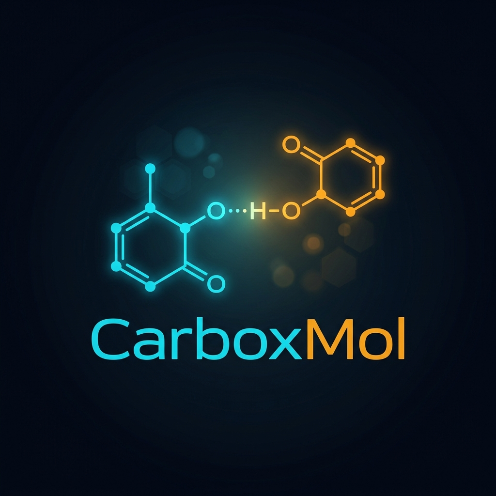

.. CarboxMol documentation master file

CarboxMol Documentation
=======================

Universal 3D Macromolecular Crystallography Workbench, Interactive WebGL Studio & GROMACS MD Suite
--------------------------------------------------------------------------------------------------

**Authors:** Suleiman M. Hajizadeh & Prof. Garib N. Murshudov (2026)

**Academic Affiliations:**
* Institute of Molecular Biology (IMB), Ministry of Science and Education of the Republic of Azerbaijan
* Western Caspian University (WCU), Baku, Azerbaijan
* MRC Laboratory of Molecular Biology (LMB), Cambridge Biomedical Campus, Cambridge, United Kingdom

.. toctree::
   :maxdepth: 2
   :caption: English Documentation (en)

   en/index
   en/workbench
   en/cli
   en/gromacs
   en/density
   en/cxl
   en/api
   en/citation

.. toctree::
   :maxdepth: 2
   :caption: Azərbaycan Sənədləşməsi (az)

   az/index
   az/workbench
   az/cli
   az/gromacs
   az/density
   az/cxl
   az/api
   az/citation

.. toctree::
   :maxdepth: 2
   :caption: תיעוד עברית (he)

   he/index
   he/workbench
   he/cli
   he/gromacs
   he/density
   he/cxl
   he/api
   he/citation

.. toctree::
   :maxdepth: 1
   :caption: Technical Reference Manual

   CARBOXMOL_USER_MANUAL
