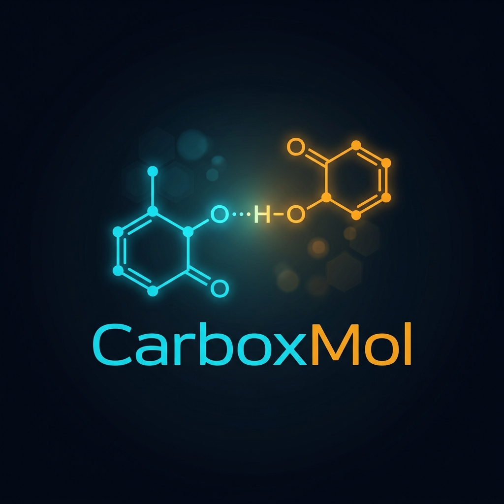

.. Carbox & CarboxMol documentation master file

Carbox & CarboxMol Documentation
=================================

Structural Identification of Anomalous Carboxyl Protonation States, Low-Barrier Hydrogen Bonds, and Microenvironment Dielectric Shielding in High-Resolution Macromolecular Crystal Structures
----------------------------------------------------------------------------------------------------------------------------------------------------------------------------

**Authors:** Suleiman M. Hajizadeh & Prof. Garib N. Murshudov (2026)

**Academic Affiliations:**
* Institute of Molecular Biology (IMB), Ministry of Science and Education of the Republic of Azerbaijan
* Western Caspian University (WCU), Baku, Azerbaijan
* MRC Laboratory of Molecular Biology (LMB), Cambridge Biomedical Campus, Cambridge, United Kingdom

.. toctree::
   :maxdepth: 2
   :caption: English Documentation (en)

   en/index
   en/carbox
   en/carboxmol
   en/restraints
   en/citation

.. toctree::
   :maxdepth: 2
   :caption: Azərbaycan Sənədləşməsi (az)

   az/index
   az/carbox
   az/carboxmol
   az/restraints
   az/citation

.. toctree::
   :maxdepth: 2
   :caption: תיעוד עברית (he)

   he/index
   he/carbox
   he/carboxmol
   he/restraints
   he/citation

.. toctree::
   :maxdepth: 1
   :caption: Scientific Manuals & Memoranda

   CARBOX_MASTER_MANUAL
   CARBOX_CRYSTALLOGRAPHIC_VALIDATION_MEMORANDUM
   CARBOX_KRISTALLOQRAFIK_DOGRVLAMA_MEMORANDUMU
   CARBOX_CRYSTALLOGRAPHIC_VALIDATION_MEMORANDUM_HE
